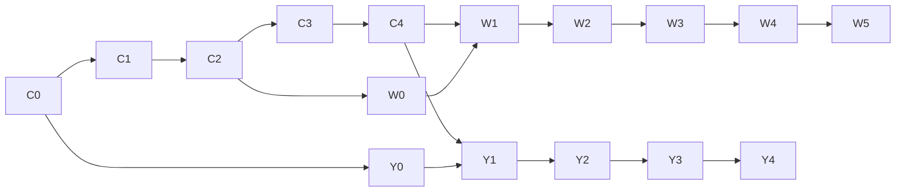

# City Bloxx — Kế hoạch phát triển Web và YouTube Playables v2.0

Ngày: 06/10/2026. Trạng thái: đề xuất triển khai, chưa phải tính năng đã hoàn thành.

**Cập nhật 07/10/2026:** C3 và C3.8 người nhảy dù đã triển khai trên hai shell; xem [PROGRESS](PROGRESS.md). Physics 0.10.0, móng không chấm điểm; band lệch Perfect ≤5%, Great ≤15%, Good ≤30%, Risky <40%, Miss ≥40%. Body 144×120. Web có trang hướng dẫn Build City; cả hai shell có guide trong game và đổi EN/VI. 8 asset population đã import; 12 building compact vẫn chờ [prompt v3](City_Bloxx_Art_Prompts_v3.0.md). Baseline cũ phía dưới không thay thế trạng thái mới này.

**Cập nhật triển khai 06/10/2026:** C0 và C2 đã hoàn thành kỹ thuật; C1 đã có đầy đủ code và kiểm thử tự động, còn playtest 5–8 người cùng benchmark điện thoại thật trước khi chốt cảm giác. Checklist, bằng chứng và phần còn chờ nằm trong [C0–C2 Acceptance](C0_C1_C2_ACCEPTANCE.md). Các phase sau vẫn là roadmap.

Nguồn sản phẩm: [GDD](City_Bloxx_Online_GDD_v1.0%20(1).md), [research](city_bloxx_research.md), [so sánh nền tảng](City_Bloxx_Web_vs_YouTube_Playables.md). Đã tham khảo production plan v1.0 trong project. Bản v2 này là kế hoạch đề xuất sử dụng tiếp; giữ nguyên tài liệu cũ để đối chiếu.

Bộ đi kèm: [Prompt và quy cách asset](City_Bloxx_Art_Prompts_v2.0.md), [hướng dẫn bỏ ảnh vào thư mục](art/README.md).

## 1. Hướng triển khai

Làm một game core dùng chung, sau đó phát hành hai sản phẩm:

| Phần | Web | YouTube Playables |
|---|---|---|
| Vai trò | Game đầy đủ dịch vụ, cạnh tranh và phát triển lâu dài | Game chơi ngay, lưu tiến trình qua YouTube, nội dung đóng gói |
| Ba mode chính | Quick Tower, Build City, Daily | Quick Tower, Build City, Daily local |
| Thành phố ban đầu | Downtown 5×5, bốn class | Cùng luật và nội dung cơ bản |
| Hồ sơ | Guest trước, tài khoản và cloud save sau | Save YouTube; không tạo tài khoản riêng |
| Cạnh tranh | Server kiểm tra run, leaderboard riêng từng mode | Một metric chuẩn gửi SDK; Daily chỉ personal best trong game |
| Replay | Cá nhân, công khai, challenge, async duel theo phase | Cá nhân và ghost bản thân, giới hạn dung lượng |
| Cosmetic lúc soft launch | Default + Classic Brick | Default + một phần thưởng cosmetic nhỏ có thể mở được |
| Cosmetic lúc public launch | Thêm Modern Glass nếu đã đạt chất lượng | Brick hoặc skin lẻ nếu còn ngân sách tải và bộ nhớ |
| Sau launch | District, social, LiveOps, shop, có thể realtime PvP | District/mission/theme theo bản cập nhật đóng gói |

MVP có 3 mode. One Drop Daily là upgrade sớm sau soft launch; đây là giảm scope có chủ đích so với launch đầy đủ trong GDD. Không bắt buộc 2–3 full theme để bắt đầu thử nghiệm retention.

**Thứ tự:** shared core → Quick Tower → Build City → Daily/meta → hai nhánh hoàn thiện nền tảng → soft launch → nâng cấp theo dữ liệu.

## 2. Hiện trạng và các việc phải xử lý sớm

Đã đọc code và danh sách file; chưa chạy build hoặc kiểm thử ứng dụng trong lượt lập kế hoạch này.

| Quan sát trong project | Hệ quả với plan |
|---|---|
| `base-game-nextjs` có Next.js/React, layout, i18n, UI và auth scaffold | Tận dụng vỏ hiện tại. `lib/api/auth.api.ts` vẫn ném lỗi TODO; chưa có auth backend thật |
| `base-playable-main` có Vite/TypeScript, game demo và host SDK | Thay demo ở `src/game`; adapter gọi host hiện có |
| `src/platform/save.ts` trả fallback nếu envelope version khác | Không tăng `VITE_SAVE_VERSION` mỗi lần đổi game schema; bổ sung migration trước khi có người chơi thật |
| Save loader gom lỗi tải thành fallback | Phải phân biệt chưa có save với tải save thất bại, tránh ghi bản rỗng đè tiến trình |
| `src/main.ts` có `forceReady()` sau 4 giây hoặc lỗi boot | Audit readiness trong Y0: chỉ báo ready khi UI tương tác được; lỗi có màn retry thực sự |
| Hai app chưa có package gameplay chung | Tạo workspace ở C0, giữ nguyên tên hai thư mục app |

README template khuyên chỉ viết game trong `src/game`. Gameplay vẫn theo cách đó; các vấn đề save/readiness là công việc nền tảng riêng, phạm vi nhỏ và có kiểm thử. Không coi template là đã đạt certification chỉ vì có SDK wrapper.

## 3. Quyết định gameplay để dev không tự suy diễn

Những lựa chọn dưới đây là thiết kế đề xuất, không khẳng định là công thức gốc J2ME.

| Chủ đề | Baseline v1 |
|---|---|
| Điều khiển | Một lệnh drop; pointer/touch, Space/Enter trên web. Nút UI không phát sinh drop xuyên xuống canvas |
| Quick Tower | Endless, ba miss kết thúc run, không roof; bắt đầu bằng residential |
| Build City | Residential 10, Industrial 20, Office 30, High-rise 40 tầng; roof là lần thả riêng |
| Adjacency | Blue bất kỳ; Red kề Blue; Green kề Blue+Red; Yellow kề Blue+Red+Green; chỉ bốn hướng |
| Phá nhà | Kiểm tra adjacency lúc xây/đặt; nhà đã tồn tại không tự mất khi phá nhà hỗ trợ. Preview thay đổi population, xác nhận phá |
| Rebuild | Giữ nhà cũ đến khi người chơi chấp nhận kết quả mới; commit một giao dịch. Có thể giữ kết quả cũ tốt hơn |
| Xây hụt | Ba miss trước roof: có thể giữ tower dở với population đã kiếm, không completion/roof bonus; zero-floor không chiếm ô |
| Roof miss | Một lần thử roof; miss thì tower hoàn thành phần thân, không roof accuracy bonus; không lặp vô hạn roof |
| Combo | Meter thời gian riêng; Perfect refresh, miss xóa; Great/Good được bonus khi meter còn; pause dừng timer |
| Streak | Chỉ Perfect liên tiếp; placement khác hoặc miss reset, độc lập combo timer |
| Rating | Quick và finite tower có công thức riêng versioned, tránh tiêu chí roof trên Quick |
| Assist/continue | Đánh dấu unranked từ đầu; không gửi vào leaderboard hoặc `sendScore` chuẩn |
| Skin | Không đổi collision, physics, score, camera visibility có lợi; class ID khác skin ID |
| Mở class | Unlock tích lũy một chiều; phá nhà không khóa lại class. Milestone tune bằng playtest |

Alignment được tính tại thời điểm va chạm với mặt trên đang sway, không lấy lúc nhấn drop. Chuẩn hóa sai lệch theo geometry trong ruleset. Kiểm tra overlap hợp lệ trước, sau đó phân band không để khoảng trống: Perfect [0,0.08], Great (0.08,0.22], Good (0.22,0.45], phần còn lại của placement hợp lệ là Risky. Ngưỡng overlap tối thiểu phải tune; không tự coi 0.75–1.0 là vùng không có kết quả.

Scoring, sway, tốc độ swing, combo duration và unlock curve là config có version. Không khóa các số 70/250/550 từ research vào progression chính thức. Không dùng độ rộng nhà 1.28/0.92/0.78 của plan cũ làm yêu cầu art cho đến khi prototype xác nhận.

## 4. Kiến trúc và thư mục code dự kiến

Gốc mọi đường dẫn là `D:\ANT_1\city-bloxx-main\`. Cây dưới là đích triển khai, chưa được tạo toàn bộ.

```text
city-bloxx-main/
├── package.json                         workspace, lệnh build/test cả hai target
├── packages/
│   ├── city-bloxx-core/src/
│   │   ├── simulation/                  fixed tick, swing, sway, collision
│   │   ├── scoring/                     population, combo, rating
│   │   ├── rules/                       immutable versioned rulesets
│   │   ├── city/                        grid, adjacency, transaction
│   │   ├── progression/                 missions, mastery, achievement
│   │   ├── replay/                      input record, resimulation
│   │   └── save/                        schema, migrations, validation
│   ├── city-bloxx-renderer/src/          Canvas2D, camera, sprites, FX
│   └── city-bloxx-content/              catalog và bundled config
│       ├── buildings.json
│       ├── cosmetics.json
│       ├── daily-schedule-v1.json
│       └── assets.manifest.json
├── base-game-nextjs/
│   ├── app/(main)/                      pages web
│   ├── app/api/                         HTTP handlers mỏng, từ W1
│   ├── modules/city-bloxx/
│   │   ├── adapters/                    save, auth, leaderboard, analytics
│   │   └── screens/                     React UI quanh renderer
│   ├── server/city-bloxx/               validation, database, service logic
│   └── public/game/                     export runtime web
├── base-playable-main/
│   ├── src/game/                        scene/state UI, host adapters
│   ├── src/platform/                    SDK infrastructure hiện có
│   └── public/game/                     export runtime YouTube
├── art/                                 master, approved và export staging
└── scripts/assets/                      kiểm tra, export, sync; làm ở C0–C3
```

Core TypeScript thuần không dùng DOM, React, clock thật, SDK hay fetch. Renderer Canvas2D dùng chung để tránh sửa cảm giác chơi hai lần; React chỉ quản lý UI web. Nếu profiling C1 chứng minh Canvas2D không đủ, đánh giá renderer khác ở đó, không đổi physics theo renderer.

Services tối thiểu: `SavePort`, `ScorePort`, `LifecyclePort`, `AudioPort`, `ClockPort`, `AssetPort`, `AnalyticsPort`. Capability bật theo phase và theo build: UI Playables không import module auth/shop/share của web. Build kiểm tra dependency để tránh bundle dịch vụ web dù nút đã ẩn.

Workspace chọn một package manager và lockfile khi C0; kiểm tra lockfile sẵn có trước khi migrate. Không di chuyển hoặc xóa hai app để làm lại từ đầu. Trước khi sửa Next code, đọc docs đi kèm bản Next theo `base-game-nextjs/AGENTS.md`.

## 5. Roadmap tổng thể và effort

Effort là ngày công kỹ thuật, chưa cộng ngày công art, vận hành nội dung hoặc thời gian YouTube xét duyệt. Giả định dev đã quen TypeScript; dự phòng thêm 25–35%. Không phải cam kết ngày phát hành.

| Phase | Phụ thuộc | Đầu ra | Ngày công |
|---|---|---|---:|
| C0 | — | Contracts, workspace, asset convention | 3–5 |
| C1 | C0 | Prototype cảm giác stacking | 7–10 |
| C2 | C1 | Quick Tower có record/replay/result | 4–6 |
| C3 | C2 | Build City 5×5 và save bền vững | 7–10 |
| C4 | C3 | Daily, missions, mastery, cosmetics | 7–10 |
| W0 | C2, hoàn thiện sau C4 | Web guest alpha | 3–5 |
| W1 | C4, W0 | Backend/save/verified ranking | 10–15 |
| W2 | W1 | Web soft launch | 5–8 |
| Y0 | C0, tích hợp dần C1–C4 | Audit SDK, save/lifecycle đúng | 4–6 |
| Y1 | C4, Y0 | Playables feature complete | 4–6 |
| Y2 | Y1 | Package/certification candidate | 5–8 |

Shared C0–C4: 28–41 ngày công. Tổng kỹ thuật để có hai bản soft-launch-ready: 59–89 ngày công trước buffer. Một dev cần khoảng 12–18 tuần làm việc trước buffer; hai dev có thể làm nhánh W và Y đồng thời sau core, nhưng không chia đôi máy móc. Y2 hoàn tất chỉ là sẵn sàng nộp; public release phụ thuộc quyền truy cập portal và kết quả review.



## 6. Shared phases

### C0 — Contracts và nền móng

Mục tiêu: hai shell import cùng core và build được, art có nơi tiếp nhận rõ ràng.

- C0.1: workspace, shared core/render/content, root build targets; giữ riêng runtime adapter.
- C0.2: chốt `RunConfig`, `DropInput`, `RunResult`, `GameSave`, capabilities và phiên bản.
- C0.3: quy định simulation 60 tick/giây, input tick + thứ tự; render nội suy độc lập FPS. Dừng game clock khi pause; không dùng Date.now trong simulation.
- C0.4: fixtures replay trên browser và Node; quy tắc PRNG/rounding. Fixed-step riêng nó chưa đảm bảo determinism: kiểm tra sai số xuyên runtime và cân nhắc integer/quantization.
- C0.5: tạo asset manifest, target allowlist, budget check; bắt đầu style anchor A00 trong art guide.
- C0.6: chọn thiết bị baseline để đo FPS/load; lập danh sách biến tuning và câu hỏi playtest.

Nghiệm thu: cả hai build import cùng version; core chạy được trong Node không DOM; thiếu asset trong manifest gây lỗi build rõ tên; chưa cần ảnh hoàn thiện. Art không chặn prototype hình chữ nhật.

### C1 — Core feel

- C1.1: state machine `prepare → swing → drop → resolve → next → end`; một input chỉ thả một block.
- C1.2: gravity, overlap, landing, tower sway từ height/error và recovery nhỏ khi Perfect.
- C1.3: ba lives, band placement, combo meter, streak, population; đổi tất cả qua ruleset.
- C1.4: camera follow top; tọa độ world không thay theo viewport; resize không đổi geometry hay kết quả.
- C1.5: cảm giác impact, Perfect, miss; âm thanh placeholder, reduced motion; tutorial ba drop đầu.
- C1.5a — Perfect streak FX (bổ sung 07/10/2026, đã triển khai dùng chung Web/Playable): Perfect đầu hiện `PERFECT`; lần 2 `DOUBLE PERFECT`; lần 3 `TRIPLE PERFECT`; từ lần 4 `PERFECT ×N`. Chữ pulse nhẹ và tia vàng tăng theo streak, tối đa 24 hạt; Reduced Motion chỉ hiện chữ, không pulse/hạt. Placement khác Perfect reset streak theo core hiện có; mái riêng hiện `PERFECT ROOF`, không cộng streak thân nhà. Không đổi score, hitbox, ruleset hoặc replay. C1.3/C1.5 cũ chỉ nói combo/Perfect tổng quát, chưa đặc tả các mốc Double/Triple.
- C1.5b — Performance polish: bỏ CSS brightness filter toàn arena khi đáp, cache background theo kích thước/DPR, chỉ cập nhật HUD/text khi giá trị đổi. Đã triển khai; chưa kết luận đạt FPS điện thoại thật. Còn đo frame-time/long tasks khi drop/impact và save City trên Android/iOS, kiểm tra 40 tầng; nếu storage gây long task thì tách ghi qua idle queue có flush khi pause/pagehide, không đánh đổi checkpoint.
- C1.5c — Âm thanh streak nâng cao còn chờ: GDD đề xuất lớp nhạc tại mốc 1/3/6/10; hiện vẫn âm thanh Perfect placeholder, chưa có adaptive music.
- C1.6: 5–8 người thử không hướng dẫn miệng; ghi hiểu lệnh drop, cảm giác lệch, frustration và retry.

Art: A00 + A01 (residential mid, crane, hook); gradient trời và UI code đủ cho thử nghiệm.

Nghiệm thu: first drop mục tiêu <10 giây từ màn tương tác; chơi được bằng chuột/touch/keyboard; 3 miss kết thúc đúng; pause giữa fall không nhảy simulation; cùng input ở render 30/60/120 FPS ra cùng kết quả. Nếu core chưa vui, lặp C1 trước khi tăng meta.

### C2 — Quick Tower hoàn chỉnh và record

- C2.1: home tối giản, retry/result, PB, thống kê height/population/accuracy/streak/time.
- C2.2: ghi seed, versions, mode, assist flags, input tick, sequence; drop outcomes chỉ là dữ liệu quan sát, server sẽ tự tính lại.
- C2.3: replay play/pause/restart; fixture có miss, combo hết giờ, sway cao.
- C2.4: assist tách ruleset và thành tích chuẩn; ngăn run assist lọt score submission.
- C2.5: local save abstraction, lỗi storage có thông báo và không crash; smoke cả hai shell.

Art: HUD/icon, feedback FX (code trước), badge rating nếu cần. Retry không đợi load lại bundle.

Nghiệm thu: retry không ads <2 giây; replay ra đúng result; key auto-repeat/double tap không phát sinh hai drop; kết quả cũ không bị đè khi tạo run mới; không memory growth rõ sau 30 run.

### C3 — Build City và tiến trình bền vững

- C3.1: 25 lot, valid-placement highlight, giải thích điều kiện còn thiếu; chọn lot rồi class.
- C3.2: bốn tier, 10/20/30/40 floors, roof, finite-tower rating và unlock curve.
- C3.3: tower dở, cancel, rebuild giữ nhà cũ, demolish; mỗi kết quả có `runId` để không cộng hai lần.
- C3.4: city transaction gồm lot/population/inventory/stats, commit đồng bộ về logic trước save.
- C3.8 (đã triển khai): popup hướng dẫn City 5 trang EN/VI + trang Web `/guide/build-city`; completion parachutists theo class/quality, giữ tower 3,6 giây trước result, Reduced Motion chỉ +population. Sprite counts P/G/Good/R theo Residential 4/3/2/1, Industrial 6/4/3/2, Office 8/6/4/3, High-rise 10/8/6/4. Đây là đại diện, không tăng dân số qua FX. Render cache small sprites, nối mắt dù với harness; pause/host pause đóng băng effect clock. Reload result không phát lại FX; count-up và phone benchmark còn chờ.
- C3.5: checkpoint ở mỗi floor resolved và khi kết thúc tower; khôi phục pending placement sau reload.
- C3.6: migration schema, validation range/ID, unknown skin fallback, giữ save gốc khi migration lỗi.
- C3.7: golden tests adjacency ở góc/cạnh/giữa; phá nhà hỗ trợ; zero-floor; reload đúng lúc result/placement.

Art: A02 (12 building modules), A03 (4 minis + lot), A04 (background); dùng cùng silhouette đã duyệt.

Nghiệm thu: hoàn thành cả bốn tier, Yellow không đặt được góc; rebuild không âm population/nhân đôi thưởng; reload giữ city và pending tower. Save lỗi phải có retry, không mặc định xóa city.

### C4 — Daily và meta MVP

- C4.1: Daily dùng `UTC date + scheduleVersion`, lấy recipe cố định trong catalog; web server trả cùng recipe. Physics update không âm thầm sửa đề đã phát.
- C4.2: ban đầu Daily finite 20 tầng, objective population, cố định class/ruleset trong ngày; các objective khác mở sau để giảm QA.
- C4.3: 3 daily missions có bộ lọc chỉ sinh nhiệm vụ khả thi theo unlock; một free reroll; 20 achievements với claim idempotent.
- C4.4: mastery bốn class, XP và cấp builder, stats; reward cosmetic không đổi sức mạnh.
- C4.5: Architecture Book, preview/select skin, crane/roof, set progress; có ít nhất một reward thực sự kiếm và trang bị được.
- C4.6: recent/PB replay bị chặn số input và byte; lưu summary nếu run quá dài, không để save tăng vô hạn.

Daily Playables dựa đồng hồ máy nên không chống chỉnh ngày được. Cùng ngày và cùng content version mới đảm bảo cùng đề; không gọi đó là thi đấu toàn cầu đã xác thực.

Art: A05 Classic Brick cho web; Playables dùng thêm một roof/crane reward từ A06. Economy MVP chỉ unlock theo mastery; City Coins/shop để phase sau.

Nghiệm thu: UTC rollover không reset active run; thưởng chỉ một lần dù reload; thay skin giữ kết quả cùng input; save điển hình có đủ 25 lot + stats + replay trong budget; có thông báo hết nội dung mở khóa.

## 7. Nhánh Web

### W0 — Web guest alpha

Phụ thuộc C2, bổ sung city/meta khi C3/C4 xong. 3–5 ngày công.

- Route `/play`, `/quick-tower`, `/build-city`, `/daily`; client canvas không chạy trong SSR.
- Chơi guest ngay, IndexedDB cho save/replay; settings nhỏ có thể localStorage. Không yêu cầu login trước tutorial.
- Khi đổi route/unmount: dọn RAF, listeners, audio, save checkpoint. Không reset game vô ý khi React re-render.
- Home ưu tiên Build City, Daily, Quick; how-to ngắn, English/Vietnamese, keyboard focus và reduced motion.
- Adapter analytics ghi `session_start`, `first_drop`, `tower_end`, `retry`, `city_place`, `daily_start/complete` với ruleset/version; không gửi từng frame.

Nghiệm thu: refresh, back navigation, mobile rotation, private browsing/storage denied có kết quả dự đoán được; không mất city vì đổi route. Nội dung SEO có text thực, không chỉ canvas.

### W1 — Backend, cloud save và bảng điểm xác thực

Phụ thuộc C4/W0. 10–15 ngày công. Đề xuất đầu tiên: API trong Next server + PostgreSQL; replay blob sang object storage khi dữ liệu tăng. Không cần microservices lúc MVP.

- W1.1: auth thật, session và quyền truy cập; public play guest vẫn hoạt động.
- W1.2: dữ liệu `players`, `save_revisions`, `runs`, `replays`, `daily_challenges`, `leaderboard_entries`, `reward_claims`.
- W1.3: guest → account có lựa chọn giữ local hoặc cloud khi xung đột; không cộng inventory hai save tùy tiện. Optimistic concurrency theo revision.
- W1.4: server cấp run ticket gồm runId, seed, versions, expiry. Nhận input log, resimulate và tự tính score; validate input order/tick count/duration/size/rate limit.
- W1.5: submission idempotent theo runId, chống gửi lại thưởng; reject unknown ruleset/assist/continue. Replay kiểm tra tính hợp lệ chưa thể loại bỏ hoàn toàn bot/tool-assisted play.
- W1.6: bảng Quick population/height và Daily population riêng, tie-break deterministic; không gộp score giữa balance version.
- W1.7: `/leaderboard`, `/my-towers`, `/tower/[id]`, profile/stats; replay tương thích version cũ hoặc thông báo không còn hỗ trợ.
- W1.8: reward/currency có giá trị và rank do server quyết định; offline chỉ personal progress/PB đến khi xác minh.

Contract API dự kiến: `GET /api/daily`, `POST /api/runs/start`, `POST /api/runs/{id}/finish`, `GET /api/leaderboards`, `GET/PUT /api/save`, `GET /api/towers/{id}`. Save PUT kèm revision; finish kèm input log và ticket, không nhận score client làm sự thật.

Nghiệm thu: đổi score request không thay điểm server; cùng run submit 2 lần chỉ có 1 entry; tài khoản A không đọc/sửa private save của B; save hai thiết bị xung đột có xử lý; mất mạng giữa submit có retry; phục hồi backup database trên staging.

### W2 — Soft launch Web

Phụ thuộc W1, 5–8 ngày công.

- Hoàn thiện tutorial, result next action, analytics dashboard và crash reporting.
- Asset default + Brick; load theme sau khi tương tác, cache versioned. Public launch thêm Glass khi chất lượng đủ.
- How-to-play, building guide, OG thật, sitemap/canonical; không index private profile hoặc URL run riêng tư.
- Kiểm tra mobile Safari/Chrome và desktop; load/FPS baseline; regression save, replay và ranked.
- Staging → nhóm thử nhỏ → soft launch; chuẩn bị rollback code/config tương thích save mới.
- Ads web có thể hoãn. Nếu tích hợp, chỉ giữa run, có frequency cap, lỗi/no-fill không chặn retry; không chạm ranked result.

Nghiệm thu: không còn lỗi nghiêm trọng làm mất tiến trình/crash/chấm sai; first drop và retry đạt mục tiêu; có khả năng quan sát funnel và rollback. Không cần friends/shop/PvP để launch.

### W3 — Retention và chia sẻ

Sau W2 và tối thiểu một chu kỳ D7; 8–12 ngày công, chia release nhỏ.

1. One Drop Daily và personal PB ghost; đo chơi lại/chơi Daily.
2. Public replay, Beat This Tower, share card/link, Hall of Fame, Skyline Album.
3. Async duel có ticket, deadline, cùng ruleset, tie-break và chống duplicate reward.
4. Friends leaderboard, request/block và kiểm soát nội dung tên hiển thị trước khi mở rộng social.

Nghiệm thu: link challenge mở đúng recipe/version; replay không hoạt động thì có thông báo; duel chỉ settle một lần. Đo challenge-open → run-start → completion; không cần realtime server ở phase này.

### W4 — Thành phố mở rộng và LiveOps

Sau W3 hoặc song song phần nội dung độc lập; 12–20 ngày công cho đợt đầu.

- Harbor rồi Old Town, landmark Clock Tower/Central Station; mỗi lần thêm một district thay vì tám district cùng lúc.
- Blueprint Narrow/Heavy/Tiny Roof, Perfect Rush 60s, Skyline Sprint; Survival/Wind sau. Mỗi mode có ruleset và bảng riêng.
- Weekly contracts, full theme Glass/Old European/Neon, architecture variants; city synergy chỉ trong ruleset không Classic.
- Remote event config có schema/signature/version, preview trên staging, kill switch. Không đổi physics của run đang chơi.
- Drop heatmap và coaching từ dữ liệu replay đã có; advanced stats là màn riêng.

Nghiệm thu: nội dung tạo bằng data + asset, không fork engine; migration district cũ đúng; tắt event không mất item đã kiếm; theo dõi district completion và mastery để điều chỉnh pacing.

### W5 — Economy, season và multiplayer nâng cao

Chỉ sau khi retention và vận hành ổn. Chia ba dự án, không coi là một sprint.

| Nhánh | Scope | Gate | Effort sơ bộ |
|---|---|---|---:|
| W5a | Coins, cosmetic shop, remove ads, season free/premium | Inventory/reward ledger server, payment webhook idempotent, restore/refund và support | 10–20 ngày |
| W5b | Season 4–6 tuần, tournament, prestige/new city | Có ít nhất một chu kỳ event vận hành ổn, preview reset và giữ collection | 10–15 ngày |
| W5c | Realtime parallel Tower Race | Async duel có nhu cầu, đủ người ghép trận, ngân sách vận hành | 20–35 ngày |

Realtime: server authority, room/matchmaking, reconnect, timeout, disconnect rule, tick synchronization và load test. Không có mechanic phá physics đối thủ trong bản đầu. Nếu gate không đạt, giữ async duel.

## 8. Nhánh YouTube Playables

### Y0 — Audit nền tảng ngay từ đầu

Làm từ C0 và tích hợp dần, 4–6 ngày công. Đây là điều kiện nền tảng, không đợi đến cuối game.

- Y0.1: xác minh SDK load trước code; readiness theo trạng thái thực; xử lý boot lỗi/asset lỗi/save load chậm, bỏ hành vi báo ready giả.
- Y0.2: phân biệt load thành công rỗng và load thất bại; không ghi mới khi chưa load thành công. Migration bên trong payload; giữ envelope ổn định sau release.
- Y0.3: pause/resume SDK dừng simulation/render/input/audio; resume không lấy elapsed wall-time bù vào fall/combo. Kiểm tra cả wrapper nền tảng hiện có.
- Y0.4: mute SDK chi phối SFX/music; local preview fallback được cô lập ngoài môi trường YouTube.
- Y0.5: responsive cực hẹp/rộng, touch + mouse; layout HUD không che landing surface, resize giữ run.
- Y0.6: clean build không có analytics/backend/fonts/CDN ngoài; scan network ở preview và Test Suite.

Nghiệm thu: scenario load lỗi không đè save; save version cũ migrate; host pause giữa drop và quảng cáo đúng; frame ready/loading/interactive được ghi trong test log. Các yêu cầu này đối chiếu [Integration requirements](https://developers.google.com/youtube/gaming/playables/certification/requirements_integration).

### Y1 — Feature complete Playables

Phụ thuộc C4/Y0, 4–6 ngày công.

- Ba mode + missions/mastery/book, menu gọn; không auth/profile form hoặc tên người chơi nhập tay.
- Save SDK gồm city, unlock, stats, daily local best, compact replay; checkpoints theo material progress, không dựa hoàn toàn vào lúc thoát.
- Metric `sendScore` đề xuất: **population cao nhất của Quick Tower standard v1**, số nguyên không âm. Không gửi Daily/City/Assist/continue vào cùng metric.
- Save lưu `standardQuickBest` tương ứng score đã gửi; fail save/submit có hàng đợi retry và reconcile, tránh khẳng định đã đồng bộ khi lỗi.
- Daily dựa UTC local và schedule đóng gói; hiển thị personal best, không bịa rank hay percentile toàn cầu.
- Default art + roof/crane thưởng nhẹ; local PB replay theo budget. Không external share, shop hay remote config.
- Ad hooks chỉ giữa run; rewarded thử cosmetic có thể làm sau launch. Ads chỉ bật khi portal/capability đã cấu hình và test được.

Nghiệm thu: gameplay parity với shared fixtures; load city đúng trên SDK thật; score/save metric nhất quán; không trộn score từ mode khác; no-fill/ad error vẫn tiếp tục chơi. Quyền ads và cấu hình portal theo [Monetization requirements](https://developers.google.com/youtube/gaming/playables/certification/requirements_monetization).

### Y2 — Tối ưu, kiểm thử và submission candidate

Phụ thuộc Y1, 5–8 ngày công chưa tính chờ review.

- `npm run package` tại app Playables; kiểm tra dist thực không chỉ source, asset path tương đối, không chứa file master.
- Chạy preview/Test Suite, upload/ingest nếu có quyền portal, test Android/iOS YouTube và browser được hỗ trợ.
- Fault injection: load/save reject, pause/resume lặp, resize khi rơi, ad close/error, audio toggle, replay lớn, update save cũ.
- Chuẩn bị title/description và thumbnail theo trường portal hiện hành; icon 512 chỉ là asset nội bộ, không coi nó là toàn bộ submission pack.
- Lưu report: build ID, ruleset, manifest, bundle/initial transfer, heap, thiết bị, test suite results và known issues.
- Release candidate không đổi luật; sửa certification thì rerun nhóm test liên quan.

Nghiệm thu: toàn bộ yêu cầu bắt buộc áp dụng đều pass; có report đo kích thước/tải thực; không lỗi mất tiến trình. Submit được khi có quyền portal; chứng nhận và lịch public là bước ngoài effort kỹ thuật.

### Y3 — Cập nhật giữ chân

Sau soft launch và có dữ liệu được platform cung cấp; 6–10 ngày công mỗi gói nhỏ.

- One Drop hoặc Perfect Rush trước, không thêm tất cả mode một lần.
- Brick/theme thưởng, Harbor, 1–2 landmarks; rotation theo lịch đã đóng gói.
- PB ghost cá nhân và stats sâu hơn khi budget save đủ; bỏ replay phụ trước khi bỏ progress.
- Migrate save release cũ; nội dung chưa có trong build không được hiển thị như tải được từ server.

Nghiệm thu: full matrix Y2 liên quan; score standard không bị luật mới thay nghĩa; budget asset/save/heap đạt; chốt cách giới thiệu nội dung mới mà không external prompt.

### Y4 — Event và quảng cáo nền tảng

Sau Y3, 5–8 ngày công cho khung đầu tiên.

- Event Winter/Neon đóng gói, timer UTC và hành vi khi người chơi offline/đổi ngày.
- Rewarded cosmetic trial, casual reroll; callback success chỉ grant một lần, cancel/no-fill không grant.
- Có thể thử casual continue nhưng gắn unranked suốt run; không cập nhật standard best.
- Tối ưu quy trình cập nhật nội dung; nếu sau này platform có capability mới, đánh giá riêng rồi mới mở backend/social.

Không đưa shop tiền thật ngoài nền tảng, web account, friends server, realtime PvP hoặc public replay vào baseline Playables.

## 9. Budget và kiểm thử phát hành

Theo [Stability & performance requirements](https://developers.google.com/youtube/gaming/playables/certification/requirements_stability): initial <30 MiB (khuyến nghị <15), total mặc định <250 MiB, từng file <30 MiB (khuyến nghị <512 KiB), save <3 MiB (khuyến nghị <500 KiB), tương tác nên <5 giây. Initial được đo đến `gameReady`, không đồng nhất với toàn bộ zip. Đo sau ingest/Test Suite; zip chỉ là ước lượng.

Budget nội bộ chặt hơn để có dư địa, không phải quy định YouTube:

| Hạng | Mục tiêu v1 |
|---|---:|
| Initial transfer | ≤8 MiB |
| Tổng gói Playables | ≤15 MiB |
| JS/CSS/fonts initial | ≤2 MiB |
| Art cần trước ready | ≤4 MiB |
| Audio initial | ≤1 MiB |
| Dự phòng initial | 1 MiB |
| Save thường xuyên, gồm envelope | <64 KiB nếu khả thi |
| Save khi đã có replay mở rộng | <256 KiB nội bộ, luôn dưới khuyến nghị 500 KiB |
| Texture memory active | ≤64 MiB nội bộ; đo bằng kích thước giải mã, không dung lượng PNG |

Background 1024×1536 RGBA giải mã khoảng 6 MiB dù file nén nhỏ. Không preload toàn bộ district/theme. Atlas chia theo mode/theme; không gom một atlas khổng lồ chỉ để giảm request.

Test bắt buộc theo rủi ro: simulation/replay fixtures; adjacency; transaction idempotency; save migration; input/lifecycle; asset manifest; server verification (Web); SDK/Test Suite (YouTube). Target render 60 FPS trên thiết bị baseline, chịu được 30 FPS mà simulation không đổi. Chốt tên thiết bị và mạng thử ở C0.

Responsive Playables phải giữ tiến trình khi đổi viewport, hỗ trợ touch/mouse và không khóa orientation; loại bỏ share prompt, external link và quit button. Xem [Design requirements](https://developers.google.com/youtube/gaming/playables/certification/requirements_design). Không external requests ngoài ngoại lệ SDK được quy định, không form thu thập thông tin cá nhân, theo [Privacy requirements](https://developers.google.com/youtube/gaming/playables/certification/requirements_privacydata).

## 10. Gate nâng cấp sau soft launch

Chưa có baseline nên các số dưới là giả thuyết quyết định nội bộ, không phải benchmark ngành.

| Gate | Cách đo | Hành động |
|---|---|---|
| Hiểu core | Playtest: ≥80% tự drop trong 10s sau interactive | Nếu thấp: sửa tutorial/input trước |
| Muốn retry | ≥40% người kết thúc run đầu bắt đầu run thứ hai | Nếu thấp: kiểm tra feel/result/loading |
| City có giá trị | ≥35% người vào city xây tiếp tower thứ hai | Nếu thấp: sửa mục tiêu/unlock/pacing |
| Daily đáng quay lại | Cohort có D1/D7, participation và completion | Chốt target từ dữ liệu launch trước khi mở nhiều mode |
| Ổn định | Không blocker mất save/chấm sai; crash-free session mục tiêu ≥99.5% | Nếu chưa đạt: ưu tiên sửa lỗi |

Web đo qua analytics của mình. Playables dùng số liệu portal có sẵn và playtest; không thêm endpoint analytics để lấy cùng funnel bằng mọi giá. Nếu platform không cung cấp metric, đánh dấu không quan sát được. Thử nhỏ chỉ cho tín hiệu định tính; không diễn giải 5–8 tester thành số retention production.

## 11. Thứ tự giao việc ngay

1. C0: workspace/contracts, Y0 audit save/readiness, thống nhất naming và manifest.
2. Art A00 để khóa style; C1 chạy bằng hình đơn giản trong lúc duyệt art.
3. A01 → C1/C2: một sàn residential, crane, hook; hoàn thiện drop/retry/replay.
4. A02/A03/A04 → C3: bốn loại nhà, city minis, lot và background.
5. C4 + A05/A06: Daily/meta, Brick cho web, reward nhỏ cho Playables.
6. W0/W1 và Y1/Y2 thành hai track riêng; branch nào đạt release gate thì phát hành thử trước.

Các đường dẫn và prompt ảnh cụ thể nằm ở [Art Prompts v2](City_Bloxx_Art_Prompts_v2.0.md). Không cần generate toàn bộ theme/landmark trước khi bắt đầu code.
