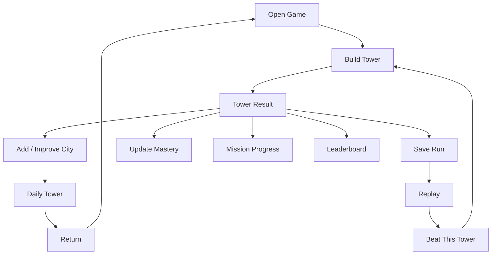

# GAME DESIGN DOCUMENT (GDD)
# CITY BLOXX ONLINE

**Document Type:** Game Design Document / Product Plan  
**Platform:** Web Browser — Desktop / Mobile / Tablet  
**Genre:** Arcade Stacking / City Building / Casual Competitive  
**Business Model:** Free-to-Play Web Game  
**Design Direction:** Giữ core one-button stacking của City Bloxx, mở rộng bằng city planning, mastery, Daily, replay, competitive, collection và LiveOps.  
**Document Version:** 1.0  
**Status:** Product / Production Draft  
**Language:** Vietnamese  

---

# 0. DOCUMENT CONTROL

## 0.1. Mục đích tài liệu

Mục tiêu không phải chỉ clone game cũ.

> **Giữ một core game cực dễ hiểu — canh và thả block — nhưng xây quanh nó một hệ sinh thái đủ sâu để người chơi muốn chơi thêm một tower, tối ưu thêm một city, quay lại Daily ngày mai và theo đuổi mastery lâu dài.**

Tài liệu dùng cho Product Owner, Game Designer, Frontend/Backend Developer, UI/UX, Artist, QA, Data, Growth và LiveOps.

## 0.2. Product thesis

Core:

```text
OBSERVE SWING
↓
TIME DROP
↓
LAND FLOOR
↓
TOWER SWAYS
↓
DROP AGAIN
```

Nếu chỉ clone:

```text
PLAY → BUILD → MISS 3 TIMES → GAME OVER → RETRY
```

Sản phẩm đề xuất:

```text
CORE STACKING
↓
TOWER RESULT
↓
PERSONAL BEST / MASTERY
↓
CITY PROGRESSION
↓
MISSIONS
↓
COLLECTION
↓
DAILY / LEADERBOARD
↓
REPLAY / GHOST
↓
EVENT / SEASON
↓
RETURN
```

---

# 1. PRODUCT OVERVIEW

## 1.1. Working title

**City Bloxx Online**

Tên cuối nên cân nhắc IP/trademark riêng. Hướng tên original:

- Skyline Drop
- Block City
- Tower City
- Skyline Builder
- Stackopolis
- City Stack
- Block Metropolis

## 1.2. Elevator pitch

Game arcade city-building trong đó người chơi chỉ cần canh thời điểm để thả từng tầng.

Đặt càng chính xác:

- tower càng thẳng;
- sway càng nhỏ;
- combo càng dài;
- population càng cao;
- city càng phát triển.

Ngoài high score, người chơi còn:

- xây city riêng;
- mở district;
- thu thập architecture set;
- hoàn thành contracts;
- chơi Daily Tower;
- cạnh tranh Perfect Streak;
- xem replay;
- thách đấu ghost;
- tham gia seasonal city event.

---

# 2. PRODUCT VISION

## 2.1. Điểm mạnh của core

- một nút;
- hiểu trong vài giây;
- tactile;
- mobile-friendly;
- mỗi drop có tension;
- lỗi nhỏ ảnh hưởng tương lai;
- skill thể hiện rõ;
- one-more-try tự nhiên;
- kết quả trực quan, dễ share.

## 2.2. Vấn đề nếu chỉ clone

- high score nhanh trở thành mục tiêu duy nhất;
- run giống nhau;
- thiếu player identity;
- city dễ thành bảng 5×5 tĩnh;
- thiếu Daily;
- thiếu social loop;
- không có replay;
- thiếu mastery;
- thiếu short-term goals;
- ít content rotation;
- tower xây xong ít giá trị;
- người chơi giỏi thiếu endgame.

## 2.3. Product strategy

```text
PURE CORE
+
META DEPTH
```

Trong active stacking:

```text
PLAYER INPUT = DROP
```

Phần phức tạp nằm trước run, giữa tower, sau result và ở city/meta layer.

---

# 3. DESIGN PHILOSOPHY

1. **Easy to Learn:** first drop < 10 giây.
2. **Hard to Master:** accuracy, streak, sway recovery, roof, speed, layout.
3. **One More Drop:** tầng sau có thể chuẩn hơn tầng trước.
4. **One More Tower:** sau result luôn có mục tiêu tiếp theo.
5. **One More Day:** Daily + missions + rank.
6. **Skill First:** ranked không pay-to-win.
7. **Fail Fast, Retry Fast:** Game Over → Retry < 2 giây.

---

# 4. TARGET AUDIENCE

## Casual arcade
Session 2–10 phút, thích game nhẹ, satisfying, score.

## Nostalgia
Người từng chơi Nokia/J2ME và browser mini games.

## Competitive mastery
Quan tâm perfect rate, combo, height, replay, Daily rank.

## Collection / city players
Quan tâm skyline, districts, landmarks, building skins.

---

# 5. CORE FANTASY

> **Xây skyline của chính mình bằng kỹ năng timing.**

```text
PRECISION → STABILITY → GROWTH → CITY PROGRESS
```

---

# 6. CORE GAMEPLAY

Desktop:

```text
Space / Click / Enter
```

Mobile:

```text
Tap
```

Loop:

```text
BLOCK SWINGS
↓
PLAYER DROPS
↓
COLLISION
↓
OVERLAP QUALITY
↓
POPULATION
↓
COMBO
↓
TOWER SWAY UPDATE
↓
NEXT BLOCK
```

---

# 7. DROP RESOLUTION

Recommended normalized alignment model:

```text
0.00 = exact center
1.00 = edge/miss boundary
```

Example tuning:

```text
Perfect: 0.00–0.08
Great:   0.08–0.22
Good:    0.22–0.45
Risky:   0.45–0.75
Miss:    insufficient overlap
```

Final threshold phải tune bằng telemetry.

Perfect reward:

```text
Perfect FX
+ combo refresh
+ population bonus
+ Perfect Streak +1
+ mastery stat
```

---

# 8. TOWER SWAY

Sway inputs:

```text
current height
alignment error history
center of mass
building type
difficulty modifier
```

Loop:

```text
poor placement
↓
sway amplitude ↑
↓
next drop harder
```

Recommended recovery:

```text
Perfect placement
→ slightly reduce accumulated instability
```

để skilled player có thể cứu run.

---

# 9. LIVES

Default:

```text
3 misses
```

HUD:

```text
● ● ●
```

---

# 10. COMBO

Perfect kích hoạt/refill combo meter.

Khi active:

```text
population multiplier
+
score multiplier
+
visual intensity
```

Tension chính:

```text
WAIT FOR SAFER ALIGNMENT
vs
DROP FAST TO KEEP COMBO
```

---

# 11. PERFECT STREAK

Tách khỏi timed combo.

```text
Perfect → Perfect → Perfect → Perfect
```

Dùng cho achievements, missions, mastery và leaderboard.

---

# 12. POPULATION

High-level:

```text
Floor Population
=
Base Floor Value
× Placement Quality
× Combo Modifier
× Building Modifier
```

Tower:

```text
Tower Population
=
Σ Floor Population
+ Roof Bonus
+ Completion Bonus
```

City:

```text
City Population
=
Σ Active Tower Population
+ District Bonuses
```

---

# 13. COMPETITIVE METRICS

Không chỉ dùng một score:

```text
Population
Height
Perfect Count
Perfect Rate
Best Perfect Streak
Max Combo
Average Alignment Error
Build Time
Misses
```

---

# 14. BUILDING TIERS

| Tier | Floors | Role | Difficulty | Capacity |
|---|---:|---|---|---|
| Residential | 10 | Entry | Easy | Low |
| Industrial | 20 | Mid | Medium | Medium |
| Office | 30 | Advanced | Hard | High |
| High-rise | 40 | End | Expert | Very High |

Production artwork nên original.

---

# 15. ROOF DROP

Sau floor cuối:

```text
FINAL ROOF DROP
```

Roof accuracy ảnh hưởng:

- population bonus;
- completion quality;
- rare roof eligibility;
- tower rating.

---

# 16. TOWER RATING

```text
C
B
A
S
S+
```

Ví dụ weighting:

```text
40% placement accuracy
25% perfect rate
15% misses
10% roof accuracy
10% combo performance
```

Rating là mastery feedback, không thay thế score.

---

# 17. CORE MODES

Launch:

```text
1. BUILD CITY
2. QUICK TOWER
3. DAILY TOWER
```

Featured mode rotate sau.

---

# 18. QUICK TOWER

Objective:

```text
BUILD AS HIGH AS POSSIBLE
```

Game Over:

```text
3 misses
```

Metrics:

- height;
- population;
- perfect rate;
- streak.

---

# 19. BUILD CITY

```text
CITY MAP
↓
CHOOSE LOT
↓
CHOOSE BUILDING
↓
BUILD
↓
RESULT
↓
PLACE TOWER
↓
CITY POPULATION
↓
UNLOCK
↓
OPTIMIZE
```

Base district:

```text
5 × 5
```

Không khóa toàn bộ game ở 25 ô. Dùng district progression.

---

# 20. CLASSIC ADJACENCY

```text
Blue: anywhere
Red: adjacent to Blue
Green: adjacent to Blue + Red
Yellow: adjacent to Blue + Red + Green
```

Orthogonal only:

```text
UP / DOWN / LEFT / RIGHT
```

---

# 21. NEW IDEA — DISTRICT SYSTEM

Các district:

```text
DOWNTOWN
HARBOR
OLD TOWN
BUSINESS DISTRICT
RIVERSIDE
TECH DISTRICT
NIGHT DISTRICT
WINTER DISTRICT
```

Mỗi district:

- 25 lots;
- unique background;
- landmark slot;
- district goals;
- modifier;
- collection.

District completion không chỉ fill map:

```text
Population target
Average tower rating
Perfect tower count
Architecture diversity
Landmark requirement
```

---

# 22. NEW IDEA — CITY SYNERGY

Chỉ dùng non-Classic:

```text
Residential + Park → happiness bonus
Office + Transit → capacity bonus
Industrial cluster → efficiency bonus
```

Không ảnh hưởng Ranked Classic.

---

# 23. NEW IDEA — LANDMARKS

Examples:

- Clock Tower
- Grand Hotel
- Radio Tower
- Observatory
- Stadium
- Central Station
- Museum
- Skyline Spire

Unlock bằng mastery, không chỉ currency.

Example:

```text
Unlock Skyline Spire:
- 100 Perfect Drops
- 5 S-Rank towers
- Complete Downtown
```

---

# 24. NEW IDEA — TOWER BLUEPRINTS

Blueprint tạo content mà không cần engine mới.

Examples:

```text
Narrow Tower
Heavy Tower
Needle Tower
Offset Tower
Tiny Roof Tower
```

---

# 25. DAILY TOWER

Mỗi ngày mọi người nhận cùng:

```text
Building
Swing Sequence Seed
Wind Pattern
Difficulty
Objective
```

Objectives:

```text
Highest Population
Best Perfect Rate
Longest Perfect Streak
Fastest Completion
Highest Tower
Fewest Misses
```

Store:

```text
seed
rulesetVersion
physicsVersion
input timestamps
drop events
result
```

---

# 26. DAILY RESULT

```text
DAILY TOWER COMPLETE

Population: 1,842
Perfect: 17
Perfect Rate: 56.7%
Best Streak: 6
Time: 01:28

Today:
#384

Top:
8%
```

---

# 27. NEW IDEA — ONE DROP CHALLENGE

```text
1 FLOOR
1 DROP
```

Cùng seed cho mọi người.

Closest to center wins.

Session:

```text
5–15 seconds
```

Giá trị:

- shareable;
- friction thấp;
- social tốt;
- Daily side challenge;
- dễ viral.

---

# 28. NEW IDEA — PERFECT RUSH

```text
Time: 60 seconds
Goal: Max Perfect Drops
```

---

# 29. NEW IDEA — SKYLINE SPRINT

```text
Complete 20-floor tower fastest
Miss = +5s
```

---

# 30. NEW IDEA — SURVIVAL

Difficulty tăng:

```text
swing speed ↑
landing tolerance ↓
wind ↑
```

Goal:

```text
survive max floors
```

---

# 31. NEW IDEA — WIND MODE

Deterministic:

```text
LEFT GUST
CALM
RIGHT GUST
```

Chỉ Featured/Event, không phá Classic.

---

# 32. CONTRACT SYSTEM

Examples:

```text
Build 20-floor office with <2 misses
Achieve 5 Perfect Drops in one tower
Add 2,000 population to Downtown
Complete tower with 50%+ Perfect Rate
```

---

# 33. DAILY MISSIONS

Recommended:

```text
3 missions/day
```

Examples:

- Land 15 Great+ floors
- Build one Red tower
- Make a Perfect Roof
- Reach Combo x8
- Play Daily Tower
- Improve one city lot

1 free reroll/day.

---

# 34. WEEKLY MISSIONS

- Build 20 towers
- Earn 50 Perfects
- Complete 5 Daily Towers
- Upgrade city by 10,000 population
- Earn 3 S ratings

---

# 35. PLAYER LEVEL

XP sources:

```text
Complete tower
Perfect Drops
Daily
Contracts
Achievements
District goals
Events
```

Level chỉ cho prestige/cosmetic/feature discovery, không tăng ranked physics.

---

# 36. BUILDER RANK

```text
Rookie
Apprentice
Builder
Architect
Master Builder
Skyline Expert
City Architect
Grand Architect
Legend
```

Rank dựa trên verified performance, không chỉ XP grind.

---

# 37. MASTERY SYSTEM

Per building:

```text
BLUE MASTERY
Lv. 7

Built: 82
Best Pop: 724
Perfect Rate: 48.3%
Best Streak: 11
S-Rank: 14
```

Rewards:

- facade;
- roof;
- badge;
- title;
- FX.

---

# 38. ACHIEVEMENTS

## Precision
First Perfect, 10, 100, 1,000 Perfects.

## Streak
5 / 10 / 20 Perfect Streak.

## Height
25 / 50 / 100 floors.

## Recovery
Recover from extreme sway.

## City
First district, 100k population, first landmark.

## Competitive
Top 10%, Top 1%, Daily Winner.

---

# 39. ARCHITECTURE BOOK

Entry:

```text
Building
Style
Tier
Best Rating
Best Population
Times Built
First Built
Best Replay
```

Styles:

- Classic Brick
- Art Deco
- Mid-Century
- Neon
- Coastal
- Alpine
- Industrial
- Retro Futurism
- Winter
- Halloween

---

# 40. NEW IDEA — SKYLINE ALBUM

Player lưu favorite skyline:

```text
SKYLINE 01
SKYLINE 02
SKYLINE 03
```

Có thể share như card/link.

---

# 41. NEW IDEA — TOWER HALL OF FAME

Pin:

```text
Tallest Tower
Best Perfect Tower
Highest Population
Fastest Tower
Favorite Tower
```

Profile có identity rõ hơn score đơn thuần.


---

# 41A. ARCHITECTURE & COSMETIC SYSTEM

Hệ thống cosmetic phải được xem là một pillar dài hạn của sản phẩm, không phải chỉ là shop skin.

Mục tiêu:

```text
PLAY
↓
UNLOCK VISUAL CONTENT
↓
CUSTOMIZE CITY
↓
COMPLETE SETS
↓
SHOW IDENTITY
↓
RETURN
```

Nguyên tắc:

> **Gameplay class và visual skin phải tách biệt.**

Skin không được thay đổi:

```text
floor count
physics
sway
perfect threshold
population formula
adjacency requirement
ranked advantage
```

Skin chỉ thay đổi:

```text
building appearance
roof appearance
crane appearance
impact FX
city visual identity
```

---

# 41B. FOUR CORE BUILDING VISUAL IDENTITIES

Trước khi sản xuất nhiều skin, cần thiết kế 4 loại building core thật mạnh, dễ nhận diện bằng silhouette.

## Residential / Blue
- thân thiện;
- compact;
- nhiều cửa sổ;
- ban công nhỏ;
- cảm giác dân cư.

```text
compact
cozy
rectangular
```

## Industrial / Red
- nặng;
- blocky;
- mechanical;
- thép/gạch;
- utility rooftop.

```text
wide
thick
mechanical
```

## Office / Green
- sạch;
- vertical;
- grid facade;
- glass/corporate.

```text
clean
vertical
glass-grid
```

## High-rise / Yellow
- iconic;
- aspirational;
- sang;
- rõ chất endgame;
- crown/roof đặc trưng.

```text
tall
elegant
signature-top
```

Rule:

> Player phải có thể nhận ra loại building ngay cả khi không nhìn màu.

---

# 41C. THEME SET SYSTEM

Một **Theme Set** hoàn chỉnh nên bao gồm:

```text
4 Building Skins
+
1 Crane Skin
+
1 Roof Style
+
1 City Palette / Background Accent
+
Optional FX
```

## Classic Brick
- Residential: brick apartment
- Industrial: brick factory
- Office: brick/glass office
- High-rise: Art Deco brick tower
- Crane: classic yellow crane
- Roof: vintage rooftop set

## Modern Glass
- Residential: modern condo
- Industrial: steel utility plant
- Office: glass office
- High-rise: luxury glass skyscraper
- Crane: clean steel crane
- Roof: modern rooftop crown

## Old European
- Residential: townhouse
- Industrial: old workshop
- Office: civic/office building
- High-rise: grand European tower
- Crane: vintage construction crane
- Roof: stone/copper details

## Neon Future
- Residential: neon housing block
- Industrial: cyber factory
- Office: holographic office tower
- High-rise: mega neon spire
- Crane: futuristic crane
- Roof: energy crown

## Winter Town
- Residential: snowy apartment
- Industrial: winter plant
- Office: frosted office tower
- High-rise: festive high-rise
- Crane: snow-covered crane
- Roof: winter rooftop set

---

# 41D. PER-TYPE BUILDING VARIANTS

Ngoài full set, mỗi class có thể có skin riêng.

Residential:
```text
Brick Apartment A
Brick Apartment B
Cozy Townhouse
Modern Condo
Retro Motel Block
```

Industrial:
```text
Red Factory
Steel Plant
Warehouse
Power Station
Retro Workshop
```

Office:
```text
Classic Office
Glass Tower
Corporate Grid
Mid-Century Office
Neon Office
```

High-rise:
```text
Art Deco Tower
Luxury Spire
Modern Skyscraper
Retro Futurist Tower
Neon Mega Tower
```

---

# 41E. MODULAR BUILDING ART SYSTEM

Recommended structure:

```text
Base
Middle Floor Module
Window Pattern
Facade Layer
Accent Layer
Top Section
Roof
Color Palette
Night Light Pattern
```

Ví dụ:

```text
1 structural base
× 5 facade styles
× 4 roof styles
× 4 palettes
```

Rule:
- silhouette vẫn phải giữ class identity;
- modular variation không được làm Residential nhìn giống High-rise;
- floor readability phải rõ khi tower sway.

---

# 41F. CRANE SKIN SYSTEM

Crane là asset có thời gian xuất hiện trên màn hình rất cao.

Examples:

```text
Classic Yellow Crane
Industrial Steel Crane
Retro Crane
Modern White Crane
Black & Gold Crane
Neon Crane
Winter Crane
Art Deco Crane
```

Crane skin là cosmetic-only trong Ranked.

Modular structure:

```text
Arm
Body
Cabin
Cable
Hook
Material
Color
FX
```

---

# 41G. ROOF SKINS

Categories:

```text
Flat Roof
Classic Crown
Glass Crown
Industrial Utility Roof
Art Deco Spire
Neon Beacon
Winter Roof
Luxury Gold Crown
```

Roof skin có thể đi theo Theme Set, mastery, achievement hoặc event.

Không tăng Roof Bonus trong Ranked.

---

# 41H. COSMETIC UNLOCK SOURCES

## Mastery
```text
Build 20 Residential Towers
→ unlock Residential Skin
```

```text
Get 50 Perfect Drops with Office
→ unlock Office Skin
```

## District Progression
```text
Complete Downtown
→ unlock Classic Brick Set
```

## Achievement
```text
10 S-Rank Towers
→ unlock Gold Roof
```

## Daily
```text
Complete 7 Daily Towers
→ unlock Daily Crane Skin
```

## Event / Season / Shop
Có thể reward hoặc bán Theme Set, Crane Skin, Roof Pack, FX Pack, Background Pack.

---

# 41I. COLLECTION COMPLETION LOOP

```text
Modern Glass Set

Residential ✓
Industrial ✓
Office ✓
High-rise LOCKED
Crane ✓

Set Completion: 80%
```

Full Set reward có thể là:

```text
Profile Badge
City Background
Unique Perfect FX
Skyline Frame
```

Mục tiêu:

> “Còn thiếu một skin nữa là hoàn thành set.”

---

# 41J. ARCHITECTURE BOOK — EXPANDED

Mỗi entry:

```text
Skin Name
Building Class
Theme Set
Rarity
Unlocked
Unlock Source
Times Used
Best Tower Rating
Best Population
First Used
Favorite
Preview
```

Filters:

```text
Residential
Industrial
Office
High-rise
Theme Set
Unlocked
Locked
Favorite
Event
```

---

# 41K. CUSTOMIZATION UI

Building select:

```text
OFFICE
Current Skin: Modern Glass
[CHANGE SKIN]

Best: S Rank
1,842 Pop
```

Crane customization:

```text
CRANE
Classic Yellow ✓
Industrial Steel
Neon
Winter
Black & Gold
```

Theme preview:

```text
MODERN GLASS
[Residential]
[Industrial]
[Office]
[High-rise]
[Crane]
Owned: 4 / 5
```

---

# 41L. SKYLINE THEME PREVIEW

Player có thể preview full city theo set trước khi unlock/mua.

Cho phép:

```text
MIX & MATCH
```

hoặc:

```text
APPLY FULL SET
```

---

# 41M. COSMETIC RARITY

Optional:

```text
Common
Rare
Epic
Legendary
Event
Prestige
```

Rarity chỉ thể hiện availability/prestige, không map sang gameplay strength.

---

# 41N. LAUNCH ART CONTENT

## Base
```text
4 Core Buildings
1 Default Crane
1 Default Roof Family
```

## Theme Set 1 — Classic Brick
```text
4 buildings
1 crane
1 roof family
```

## Theme Set 2 — Modern Glass
```text
4 buildings
1 crane
1 roof family
```

## Theme Set 3 — Neon Future
```text
4 buildings
1 crane
1 roof family
```

Launch target:

```text
16 Building Visuals
4 Crane Visuals
4 Roof Families
```

Có thể giảm nếu art budget hạn chế.

---

# 41O. PHASE 2 ART CONTENT

```text
Old European
Art Deco Nights
Industrial Retro
Coastal City
Winter Town
Mid-Century
```

---

# 41P. PHASE 3 ART CONTENT

```text
Season-exclusive Sets
Prestige Sets
Legendary Landmark Sets
Animated Premium Skins
Dynamic Night Lighting
Event FX Sets
```

---

# 41Q. ART PRODUCTION PRIORITY

```text
STEP 1
4 core building silhouettes
↓
STEP 2
Default crane + roof language
↓
STEP 3
2–3 complete Theme Sets
↓
STEP 4
Per-building variants
↓
STEP 5
Crane/roof/FX expansion
↓
STEP 6
Seasonal / prestige cosmetics
```

> Không sản xuất 50 skin trước khi 4 core building identities thật sự tốt.

---

# 41R. COSMETIC FAIRNESS RULE

Ranked:

```text
Skin = visual only
```

Never allow:

```text
larger collision box
slower swing
wider perfect threshold
higher population
extra life
better roof bonus
```

Paid cosmetics phải dùng cùng gameplay geometry/collision logic với default skin.

---

# 41S. COSMETIC RETENTION LOOP

```text
PLAY
↓
MASTERY / MISSION / EVENT
↓
UNLOCK SKIN
↓
CUSTOMIZE BUILDING
↓
CITY LOOKS BETTER
↓
COMPLETE SET
↓
SHOWCASE CITY
↓
CHASE NEXT SET
```

Đây là long-term casual retention pillar song song với competitive mastery.

---

# 42. STATISTICS

Global:

```text
Towers Built
Floors Dropped
Perfect Drops
Perfect Rate
Great Rate
Misses
Average Alignment Error
Total Population
Highest Tower
Best Combo
Best Streak
Total Play Time
```

Per building:

```text
average error
median error
left bias
right bias
early drop bias
late drop bias
performance by floor height
performance under sway
roof accuracy
```

---

# 43. NEW IDEA — DROP HEATMAP

Visualize landing offset distribution.

Use cases:

- player tends to drop early;
- player tends to overshoot;
- compare last 10 vs lifetime;
- compare with top 10% players.

Phase 2/3.

---

# 44. MY TOWERS / RUN HISTORY

| Date | Mode | Floors | Pop | Perfect | Streak | Rating |
|---|---|---:|---:|---:|---:|---|
| Oct 05 | Daily | 30 | 1,842 | 17 | 6 | S |
| Oct 05 | Quick | 54 | 3,102 | 21 | 8 | A |
| Oct 04 | City | 20 | 976 | 9 | 4 | B |

Actions:

```text
VIEW
REPLAY
SHARE
CHALLENGE
```

---

# 45. RECORD ENGINE

Record Engine là infrastructure cốt lõi.

Không quay video.

Store:

```text
runId
playerId
mode
rulesetVersion
physicsVersion
seed
buildingType
startTime
endTime
floorCount
population
result
```

Drop event:

```json
{
  "floor": 12,
  "inputMs": 28431,
  "blockX": 0.4221,
  "towerTopX": 0.4082,
  "overlap": 0.941,
  "quality": "PERFECT"
}
```

---

# 46. WHY REPLAY MATTERS

Replay cho thấy actual skill:

- risky saves;
- perfect streak;
- sway recovery;
- final roof;
- last-life comeback;
- exact timing.

Replay nên là social/competitive pillar, không chỉ history.

---

# 47. REPLAY VIEWER

Controls:

```text
Play
Pause
Previous Drop
Next Drop
Restart
0.5x
1x
2x
4x
```

Timeline markers:

```text
Perfect
Combo x10
Height PB
Last Life
Roof
Game Over
```

---

# 48. GHOST CHALLENGE

Không nên render full second tower gây rối.

Recommended ghost UI:

```text
Opponent Height
Opponent Population
Opponent Perfect Count
Time Delta
```

Optional:

- faint opponent top marker;
- post-floor comparison.

---

# 49. BEAT THIS TOWER

Replay CTA:

```text
BEAT THIS TOWER
```

Start same:

```text
seed
rules
building
wind
physics
```

Compare:

```text
population
perfect rate
time
height
```

---

# 50. LEADERBOARDS

## Quick Tower

- Highest Floors
- Highest Population
- Best Perfect Rate (minimum floors)
- Longest Perfect Streak

## Daily

- Daily Population
- Daily Perfect Rate
- Daily Fastest Completion

## City

- Highest City Population
- Highest District Efficiency
- Most S Towers

## Seasonal

- Season Rating
- Event Points

---

# 51. LEADERBOARD FAIRNESS

Ranked run:

```text
NO POWERUPS
NO CONTINUE ADS
NO PAID BOOST
NO MODIFIED PHYSICS
```

Only verified runs accepted.

---

# 52. SOCIAL

MVP:

```text
Share Result
Share Replay
Beat My Tower
Profile
Friends Leaderboard
```

Không cần guild lúc launch.

---

# 53. SHARE CARD

```text
DAILY TOWER

30 Floors
Population 1,842
Perfect 56.7%
Streak 6
Top 8%

Can you build better?
```

Deep link mở đúng Daily/Challenge.

---

# 54. RESULT SCREEN

Không chỉ:

```text
GAME OVER
RETRY
```

Recommended:

```text
TOWER COMPLETE

Population
1,842

Floors
30

Perfect
17 / 30

Best Streak
6

Rating
S

NEW PERSONAL BEST

Daily Mission +1
Builder XP +85

[BUILD AGAIN]
[ADD TO CITY]
[WATCH REPLAY]
[VIEW RANK]
[SHARE]
```

---

# 55. LOSS RESULT

Khi fail:

```text
TOWER ENDED

Reached Floor 26
Best: 31

Perfect Rate: 52%
Previous Best: 49%

NEW ACCURACY RECORD
```

Result screen nên luôn tìm next action và, nếu có, một thành tích tích cực thật sự.

---

# 56. RETENTION MODEL

## Second-to-second

```text
Swing anticipation
Drop
Impact
Perfect feedback
```

## 10-second

```text
Combo preservation
Tower sway
Recovery
```

## Minute-to-minute

```text
Finish tower
Beat PB
Roof
```

## Run-to-run

```text
Improve rating
Complete contract
Fill city lot
```

## Day-to-day

```text
Daily Tower
Daily missions
Streak
```

## Week-to-week

```text
Weekly contracts
Rank
District goals
```

## Month-to-month

```text
Season
Architecture set
Event district
Landmarks
```

## Long-term

```text
Mastery
City history
Hall of Fame
Prestige
```

---

# 57. RETURN TRIGGERS

Healthy return triggers:

```text
New Daily Tower
District almost complete
Contract reset
Friend beat your tower
New PB target
Event milestone
```

Avoid excessive/manipulative notifications.

---

# 58. DAILY STREAK

Recommended:

```text
Play Daily = streak credit
```

Không yêu cầu win.

Optional:

```text
1 earned streak freeze
```

---

# 59. EVENT SYSTEM

Events reuse core systems.

Example:

```text
WINTER SKYLINE
```

Event content:

- winter architecture;
- special district skin;
- event contracts;
- special landmark;
- featured blueprint;
- event leaderboard.

Core Ranked physics không đổi.

---

# 60. SEASON

Recommended:

```text
4–6 weeks
```

Contains:

```text
Season XP
Season Contracts
Season Rank
Free Cosmetics
Premium Cosmetics optional
Featured Blueprint Rotation
```

---

# 61. NEW IDEA — CITY EVOLUTION

Visible progression:

```text
Village
↓
Town
↓
City
↓
Metro
↓
Metropolis
↓
Megacity
```

Unlock visual evolution:

- background detail;
- traffic;
- skyline lighting;
- district access;
- landmarks.

Không cần resource timers.

---

# 62. NEW IDEA — PRESTIGE / FOUND NEW CITY

Phase 3 only.

After Megacity:

```text
FOUND NEW CITY
```

Keep:

- collection;
- cosmetics;
- mastery;
- achievements;
- profile;
- replay history.

Reset selected city progression for prestige badge/title.

---

# 63. ECONOMY

Soft currency:

```text
City Coins
```

Earn:

- runs;
- missions;
- achievements;
- events.

Spend:

- cosmetic facade;
- crane skin;
- background;
- profile items;
- unranked decoration.

---

# 64. NO ENERGY SYSTEM

Không nên dùng:

```text
energy
tickets
life refill timer
```

Core này phụ thuộc mạnh vào:

```text
One More Run
```

Energy gate phá loop.

---

# 65. MONETIZATION

Recommended:

```text
Ads
+
Remove Ads
+
Cosmetics
+
Optional Season Pass
```

---

# 66. REWARDED ADS

Allowed:

- cosmetic trial;
- casual contract reroll;
- event currency bonus;
- casual continue.

Never affect Ranked.

---

# 67. INTERSTITIAL POLICY

Only between runs.

Never:

- during swing;
- before roof;
- mid combo;
- after every micro-run.

Need frequency cap.

---

# 68. COSMETICS

Cosmetic system phải liên kết trực tiếp với Architecture & Cosmetic System.

Potential:

```text
Full Theme Set
Per-Type Building Skin
Building Facade
Roof Style
Crane Skin
Cable Style
Impact FX
Perfect FX
City Background
Night Theme
Profile Frame
Badge
Avatar
```

Recommended hierarchy:

```text
Theme Set
↓
4 Building Skins
+ Crane
+ Roof
+ Optional FX
```

Cosmetic monetization không được ảnh hưởng gameplay geometry hoặc Ranked performance.

---

# 69. FIRST-TIME USER EXPERIENCE

Targets:

```text
First Drop < 10 sec
First Perfect Feedback < 30 sec
First Tower Result < 3 min
```

Tutorial:

```text
Tap to drop.
Center the floor.
Build higher.
```

Teach combo after first Perfect.

Teach city after first tower.

---

# 70. DIFFICULTY CURVE

Early floors:

- slower swing;
- generous threshold;
- lower sway.

Late floors:

- normal threshold;
- more sway;
- higher tension.

Do not change physics secretly based on spending.

---

# 71. ASSIST MODE

Unranked options:

```text
Slow Swing
Wide Perfect Guide
Reduced Sway
Landing Guide
```

Clearly label:

```text
ASSIST MODE — UNRANKED
```

---

# 72. HOME UX

Recommended hierarchy:

```text
[BUILD CITY]

DAILY TOWER
Today's Rank: —

QUICK TOWER

FEATURED CHALLENGE

Recent Tower
Mission Progress
```

Không show 10 equal mode cards.

---

# 73. GAME HUD

Minimal:

```text
Population
Floor
Combo
Lives
Perfect Streak (optional)
```

Tower phải là visual priority.

---

# 74. MOBILE UX

Entire gameplay viewport can receive tap.

Avoid tiny button.

Prevent:

- scroll;
- zoom;
- double-tap conflict;
- accidental browser gestures.

---

# 75. VISUAL FEEDBACK

Perfect:

- sharp impact;
- micro freeze;
- clean flash;
- distinct sound;
- population burst.

Miss:

- clear fall;
- readable camera;
- short recovery.

---

# 76. CAMERA

Rules:

- landing surface always visible;
- no excessive shake;
- predictable follow;
- tower top readable;
- quick transitions.

---

# 77. AUDIO

Perfect streak can add music layers:

```text
Perfect 1 → base
Perfect 3 → percussion
Perfect 6 → harmony
Perfect 10 → full motif
```

Break streak returns smoothly.

---

# 78. SAVE SYSTEM

Save:

```text
active city
completed towers
districts
missions
settings
profile
collection
stats
```

Build City progress must never be lost.

---

# 79. BACKEND SERVICES

```text
Auth
Player
City
Run Record
Leaderboard
Daily
Mission
Achievement
Mastery
Collection
Event
Economy
Analytics
Anti-Cheat
```

---

# 80. DATA ENTITIES

```text
Player
City
District
Lot
BuildingDefinition
BuiltTower
GameRun
DropEvent
Replay
RuleSet
DailyChallenge
Mission
Achievement
Mastery
Leaderboard
Event
Reward
Inventory
```

---

# 81. ANTI-CHEAT

Do not trust client for:

```text
population
score
perfect count
rank
currency
achievement
```

Competitive payload:

```text
ruleset
seed
drop timestamps
drop outcomes
reported result
```

Server validates.

---

# 82. PHYSICS VERSIONING

Store:

```text
physicsVersion
rulesetVersion
recordVersion
```

Tiny physics changes can invalidate replay/leaderboard fairness.

---

# 83. ANALYTICS — PRODUCT KPI

```text
DAU
WAU
MAU
D1
D7
D30
Sessions / DAU
Runs / Session
Session Length
Daily Participation
```

---

# 84. CORE GAMEPLAY KPI

```text
First Drop Rate
First Perfect Rate
First Tower Completion
First Retry Rate
Average Floor Reached
Miss Distribution
Perfect Rate
Average Alignment Error
Average Tower Duration
Roof Completion Rate
```

---

# 85. FIRST SESSION FUNNEL

```text
Landing
↓
Start
↓
First Drop
↓
First Perfect
↓
First Miss
↓
Tower End
↓
Result
↓
Retry
↓
Second Tower
↓
Build City
↓
Daily
↓
Return D1
```

---

# 86. SKILL FUNNEL

Track:

```text
% players 10% Perfect
% players 25% Perfect
% players 40% Perfect
% players 60% Perfect
% reaching streak 5
% reaching streak 10
% reaching 30 floors
% reaching 50 floors
```

---

# 87. CITY FUNNEL

```text
First Tower
First Lot
First Red
First Green
First Yellow
First District Complete
First Landmark
First 10k Population
First 100k Population
```

---

# 88. A/B TESTING

| Test | A | B | Primary Metric |
|---|---|---|---|
| Perfect feedback | subtle | strong | retry |
| Result | retry only | rich result | second run |
| Daily | nav | home card | participation |
| City unlock | 1 tower | 3 towers | retention |
| Mission count | 3 | 5 | completion/fatigue |
| Lives UI | icons | text | comprehension |
| Combo UI | bar | ring | combo usage |

---

# 89. SEO / WEB PRODUCT

Suggested routes:

```text
/
 /play
 /build-city
 /quick-tower
 /daily
 /challenge
 /leaderboard
 /tower/{id}
 /player/{id}
 /my-towers
 /city/{id}
 /statistics
 /buildings
 /how-to-play
 /strategy
 /perfect-drop-guide
 /events
```

---

# 90. CONTENT PAGES

Potential:

```text
How to Play Tower Stacking Games
How to Get Perfect Drops
Tower Stacking Strategy
How Tower Sway Works
Best City Layout Strategy
Daily Tower Challenge
Highest Tower Records
```

Use original branding/content.

---

# 91. MVP DEFINITION

MVP must prove:

```text
core feels good
players retry
players care about city
Daily creates return
leaderboard creates aspiration
```

---

# 92. MVP CORE — P0

```text
Core Drop Physics
Tower Sway
3 Misses
Perfect / Great / Good
Population
Combo
Roof
Quick Tower
Build City
5×5 District
Blue / Red / Green / Yellow
Save
Responsive Mobile
```

---

# 93. MVP COMPETITIVE — P0

```text
Daily Tower
Daily Seed / Ruleset
Leaderboard
Verified Run
Basic Replay
Run History
```

---

# 94. MVP META — P1

```text
Profile
Player Level
Basic Mastery
3 Daily Missions
15–25 Achievements
Architecture Book
Basic Stats
```

---

# 95. MVP WEB PRODUCT — P1

```text
Home
Play
Build City
Daily
Leaderboard
My Towers
Profile
How to Play
Strategy
Building Guide
```

---

# 96. MVP PRIORITY MATRIX

| Feature | Priority |
|---|---|
| Core stacking | P0 |
| Tower physics | P0 |
| Mobile tap | P0 |
| Quick Tower | P0 |
| Build City | P0 |
| Save | P0 |
| Population | P0 |
| Perfect / Combo | P0 |
| Daily Tower | P0 |
| Run Record | P0 |
| Leaderboard | P0 |
| Replay basic | P0 |
| Anti-cheat validation | P0 |
| Profile | P1 |
| Stats | P1 |
| Missions | P1 |
| Achievements | P1 |
| Architecture Book | P1 |
| Building Skin System | P1 |
| Crane Skin System | P1 |
| Theme Set System | P1 |
| Player Level | P1 |
| Mastery | P1 |
| One Drop Daily | P1 |
| Featured Mode | P2 |
| District Expansion | P2 |
| Landmarks | P2 |
| Ghost | P2 |
| Beat This Tower | P2 |
| Friends | P2 |
| Events | P2 |
| Seasons | P3 |
| Prestige City | P3 |
| Tournament | P3 |
| Advanced Heatmap | P3 |

---

# 97. RECOMMENDED LAUNCH PRODUCT

```text
BUILD CITY
+
QUICK TOWER
+
DAILY TOWER
+
DAILY ONE DROP
+
LEADERBOARD
+
MY TOWERS
+
BASIC REPLAY
+
STATISTICS
+
ACHIEVEMENTS
+
DAILY MISSIONS
+
ARCHITECTURE COLLECTION
+
BUILDING SKINS
+
CRANE SKINS
+
2–3 COMPLETE THEME SETS
```

Không cần 10 mode ở launch. Cosmetic content nên ưu tiên ít nhưng chất lượng cao, đặc biệt là 4 building identities và các set hoàn chỉnh.

---

# 98. PHASE 2

Chỉ add sau khi chứng minh:

```text
retry rate healthy
D1 meaningful
Daily participation healthy
Build City engagement healthy
```

Then:

```text
District Expansion
Landmarks
Perfect Rush
Skyline Sprint
Blueprint Challenges
Advanced Statistics
Beat This Tower
Personal Best Ghost
Friends Leaderboard
Featured Rotation
City Share
Tower Hall of Fame
Additional Theme Sets
Per-Type Building Variants
Advanced Crane / Roof Cosmetics
```

---

# 99. PHASE 3

```text
Season
Event Districts
Tournament
Ranked Ghost
Prestige City
Advanced Replay
Drop Heatmap
Alignment Coaching
Season Pass
Expanded Cosmetic Economy
Animated Premium Skins
Prestige Architecture Sets
Season-exclusive Theme Sets
```

---

# 100. WHY NOT 10 MODES AT LAUNCH

Risks:

```text
Choice overload
Empty leaderboards
QA explosion
Physics balancing complexity
Player-base fragmentation
Weak discovery
Too much UI
```

Home:

```text
BUILD CITY
DAILY
QUICK
FEATURED
```

---

# 101. PRODUCT DIFFERENTIATION

Basic clone:

```text
Open
Drop
Build
Game Over
Retry
Leave
```

Proposed:

```text
Open
↓
Build City / Daily
↓
Tower
↓
Result
↓
PB / Rating
↓
Add to City
↓
Mission
↓
Mastery
↓
Collection
↓
Replay
↓
Leaderboard
↓
Challenge Friend
↓
Return Tomorrow
```

---

# 102. RETENTION PILLARS

## Mechanical mastery
Perfect, combo, sway recovery, roof, speed.

## Persistent construction
Every good tower changes the city.

## Short goals
Contracts, Missions, Achievements.

## Daily competition
Same challenge, fair comparison.

## Identity
City, Skyline, Facade, Profile, Hall of Fame.

## Long-term content
Districts, Landmarks, Collection, Events, Season.

## Cosmetic collection
Theme Sets, Building Skins, Crane Skins, Roofs và Skyline customization tạo mục tiêu lâu dài mà không phá core gameplay.

---

# 103. HIGHEST-VALUE NEW IDEAS

1. **Daily One Drop** — micro challenge 5–15s, fair, shareable.
2. **District progression** — vượt giới hạn một board 5×5.
3. **Tower Hall of Fame** — biến run cũ thành tài sản profile.
4. **Architecture Book** — collection không phá fairness.
5. **Beat This Tower** — replay trở thành acquisition/social loop.
6. **Drop Heatmap** — mastery feature khác biệt.
7. **Blueprint Challenges** — content variety không fork engine.
8. **Landmark Builds** — aspirational long-term goal.

---

# 104. FEATURES TO AVOID EARLY

```text
Complex resource production
Real-time construction timers
Energy system
PvP physics interference
Loot boxes affecting stats
Dozens of currencies
Heavy city simulation
Guild systems
Live PvP at MVP
```

---

# 105. CORE TECHNICAL PRINCIPLE

> **Physics + record system phải được thiết kế cùng nhau.**

Need:

```text
Fixed-step simulation
Seeded/reproducible sequences where possible
Physics versioning
Input timestamp recording
Serializable tower state
Server validation strategy
```

---

# 106. GAME STATE MACHINE

```text
HOME
↓
MODE_SELECT
↓
PREPARE_RUN
↓
SWING
↓
DROP
↓
RESOLVE
↓
RESULT_FLOOR
↓
NEXT_FLOOR
↓
ROOF / GAME_OVER
↓
RUN_RESULT
↓
CITY / RETRY / REPLAY / RANK
```

---

# 107. CORE RUN DATA

```json
{
  "runId": "run_10294",
  "mode": "daily",
  "rulesetVersion": "daily-1.0",
  "physicsVersion": "physics-1.0",
  "seed": 481922,
  "building": "office",
  "floors": 30,
  "population": 1842,
  "perfectCount": 17,
  "bestPerfectStreak": 6,
  "misses": 1,
  "durationMs": 88200,
  "rating": "S"
}
```

---

# 108. DEFINITION OF DONE — SOFT LAUNCH

1. Drop responsive desktop/mobile.
2. Physics stable at target FPS.
3. Perfect detection reliable.
4. 3-miss flow correct.
5. Quick Tower retry <2 sec.
6. Build City save never loses tower.
7. Adjacency rules validated.
8. Daily fair/repeatable.
9. Competitive result validates.
10. Replay works for supported ruleset.
11. My Towers history works.
12. Leaderboard verified-only.
13. Missions update correctly.
14. Stats trustworthy.
15. Result pushes clear next action.
16. No ad interrupts active drop.
17. Guest can play immediately.
18. First drop <10 sec.
19. Analytics funnel complete.
20. Art assets original/cleared.

---

# 109. SUCCESS QUESTIONS

Soft launch must answer:

```text
Do players understand drop immediately?
Do they retry?
Do they care about Perfect?
Do they finish first tower?
Do they add tower to city?
Do they return for Daily?
Do they improve accuracy?
Do they view rankings?
Do they watch/share replay?
```

---

# 110. PRODUCT NORTH STAR

Candidate:

```text
Weekly Verified Towers Built per Returning Player
```

Supporting:

```text
Retry Rate
Daily Participation
Perfect Rate Improvement
City Progression
D1
D7
```

---

# 111. FINAL PRODUCT LOOP



---

# 112. DEVELOPMENT PRINCIPLES

1. Core drop feel quan trọng hơn meta.
2. Build City là persistent backbone.
3. Daily là retention pillar.
4. Replay là competitive/social infrastructure.
5. Physics phải versioned.
6. Ranked không paid advantage.
7. Không tin score client.
8. Result Screen luôn có next action.
9. Mobile phải tốt ngang desktop.
10. Không energy gate.
11. Không launch quá nhiều mode.
12. Mọi tower quan trọng phải tạo dữ liệu lâu dài.
13. Stats phải cho player thấy họ giỏi lên.
14. City phải thể hiện lịch sử chơi.
15. Content mới ưu tiên RuleSet/Blueprint thay vì fork engine.
16. Building class logic phải tách khỏi visual skin.
17. 4 core building silhouettes phải mạnh trước khi scale skin content.
18. Cosmetic không bao giờ thay gameplay geometry trong Ranked.

---

# 113. ONE-SENTENCE PRODUCT RULE

> **Giữ thao tác City Bloxx đơn giản như game gốc, nhưng biến mỗi cú drop thành mastery, mỗi tower thành tài sản lâu dài của city, và dùng Daily + Replay + Competition + Collection để khiến người chơi có lý do quay lại.**

---

# APPENDIX A — FEATURE PRIORITY

| System | MVP | Phase 2 | Phase 3 |
|---|:---:|:---:|:---:|
| Quick Tower | ✓ | | |
| Build City | ✓ | advanced | |
| Daily Tower | ✓ | | |
| One Drop Daily | ✓ | | |
| Record | ✓ | | |
| Replay | basic | advanced | |
| Leaderboard | ✓ | advanced | |
| Stats | ✓ | advanced | |
| Missions | ✓ | advanced | |
| Achievements | ✓ | advanced | |
| Architecture Book | ✓ | advanced | |
| Mastery | basic | ✓ | |
| Districts | 1 | ✓ | advanced |
| Landmarks | | ✓ | advanced |
| Blueprint Challenge | | ✓ | |
| Perfect Rush | | ✓ | |
| Skyline Sprint | | ✓ | |
| Ghost | | ✓ | |
| Beat This Tower | | ✓ | |
| Friends | | ✓ | |
| Events | | ✓ | advanced |
| Seasons | | | ✓ |
| Prestige | | | ✓ |
| Drop Heatmap | | | ✓ |
| Cosmetic Economy | basic | ✓ | advanced |

---

# APPENDIX B — EXAMPLE DAILY RULESET

```json
{
  "id": "daily-population-1.0",
  "date": "2026-10-05",
  "building": "office",
  "floors": 30,
  "lives": 3,
  "seed": 481922,
  "physicsVersion": "physics-1.0",
  "swingProfile": "daily-standard",
  "windProfile": "none",
  "perfectThreshold": 0.08,
  "leaderboard": "population",
  "powerups": false,
  "continue": false,
  "competitive": true
}
```

---

# APPENDIX C — RESEARCH / VALIDATION TODO

Các thông số phải prototype + telemetry trước khi lock:

- perfect threshold;
- miss overlap threshold;
- sway growth;
- sway recovery;
- combo timer;
- population multiplier;
- roof bonus;
- daily reproducibility;
- replay determinism;
- district progression pace;
- XP curve;
- mission difficulty;
- ad frequency;
- season duration.

---

# APPENDIX D — PRODUCT RISKS

## Core physics không satisfying
Mitigation: prototype core trước meta.

## City quá nông
Mitigation: district goals, landmarks, optimization, persistent tower history.

## City quá phức tạp
Mitigation: giữ simulation nhẹ, tập trung layout + collection.

## Competitive unfair
Mitigation: versioned physics, verified runs, no ranked boosts.

## Daily repetitive
Mitigation: objective rotation, blueprint rotation, One Drop.

## Content production cost cao
Mitigation: reuse core engine, architecture skins, modifiers, blueprints.
